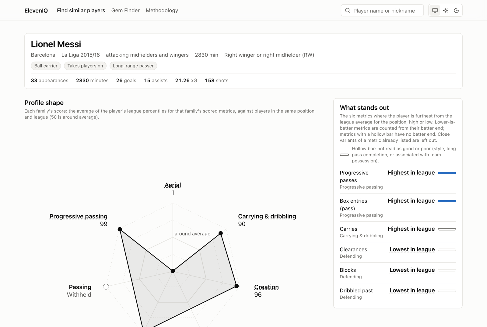
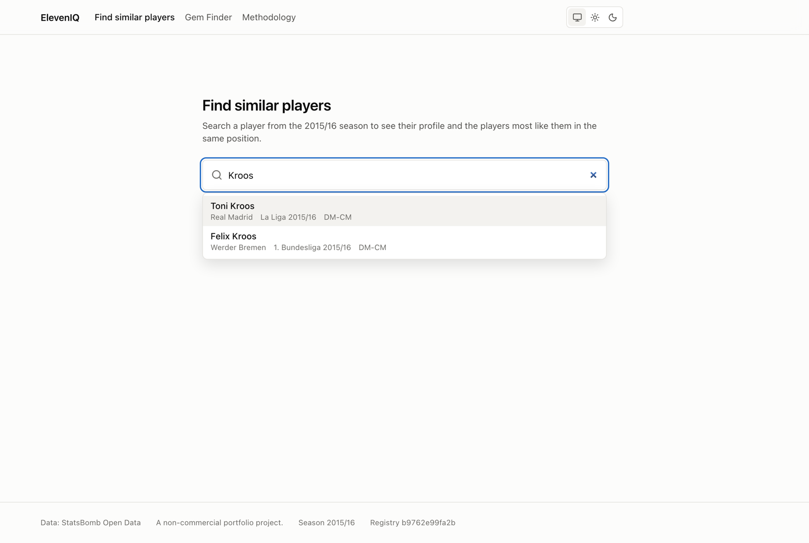
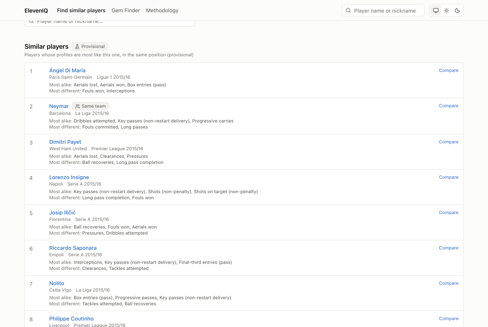
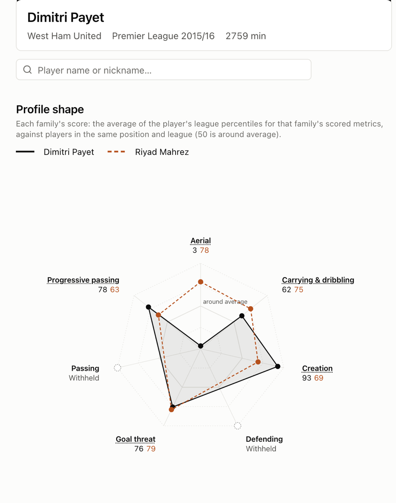
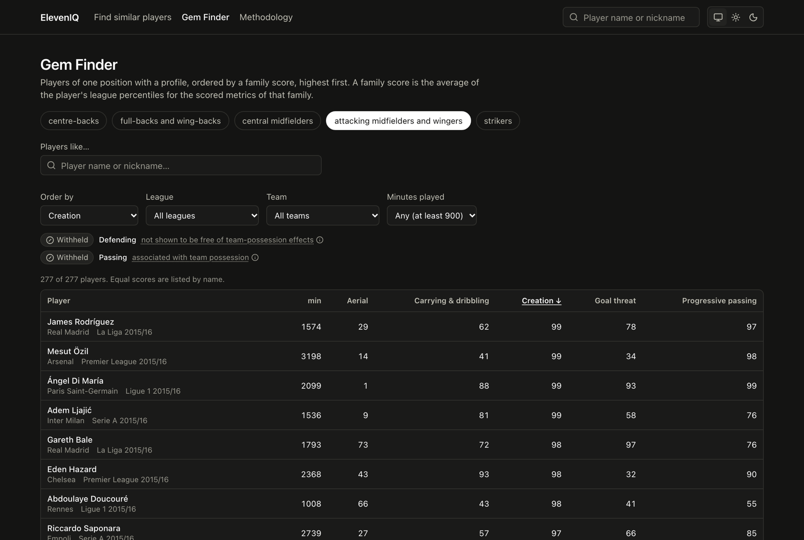
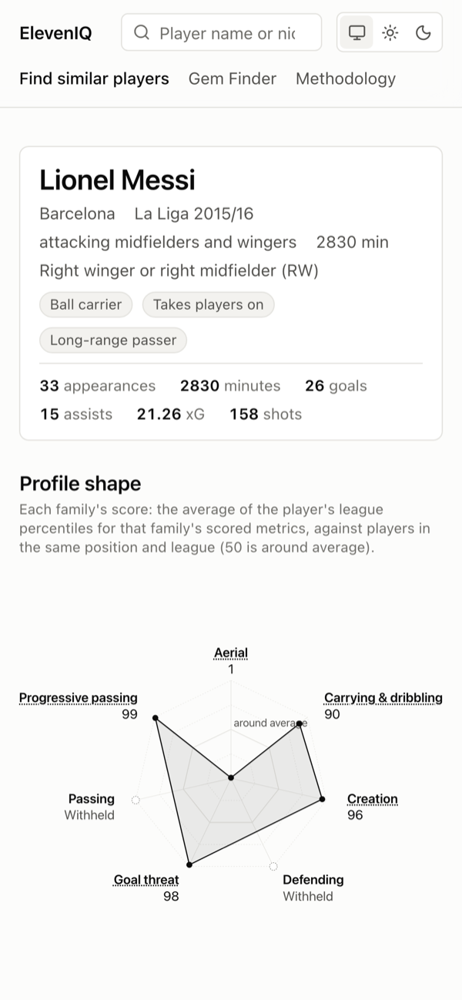
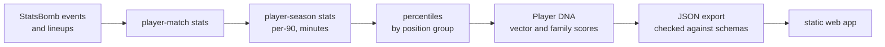

# ElevenIQ

**Football scouting from event data.** Search a player and see their statistical profile, the
players most like them in the same position, a side-by-side comparison, and a Gem Finder that
ranks a position by any part of the profile. Built end to end, from raw event files to a web
app, on [StatsBomb Open Data](https://github.com/statsbomb/open-data) for the 2015/16 season.

A personal, non-commercial portfolio project.

<p align="center">
  
</p>

## At a glance

| | |
|---|---|
| **Data** | 2,628 player-seasons from La Liga, Premier League, Serie A, Ligue 1 and the Bundesliga (partly covered), 2015/16 |
| **Pipeline** | Python 3.11 and Polars: raw StatsBomb events to per-match and per-season Parquet tables, then percentiles, Player DNA and a versioned JSON export |
| **Statistics** | per-90 metrics, percentiles within position groups, a minimum-minutes gate, robust z-scores, a weighted distance between profiles |
| **Web** | React, TypeScript, Vite and Tailwind; a static site that reads the JSON export |
| **Quality** | 2,600+ pytest unit tests, integration tests on the real data, independent reference scripts, JSON Schema contracts, Vitest, and Playwright with axe accessibility checks |
| **Decisions** | every methodology choice recorded as an ADR in [`docs/decisions/`](docs/decisions/) |

## What you can do

### Find a player

Search by name or nickname across every league in the data.



### Read a profile

The player page shows the **profile shape**: one score per family of metrics (progressive
passing, carrying and dribbling, creation, goal threat and so on). Each score is the average
of the player's league percentiles for that family, measured against players in the **same
position and league**. Next to it, **what stands out** lists the metrics where the player is
furthest from the average for the position. The full metric table below gives every value per
90 minutes, with the season total next to it.

### Find similar players

Each player's profile is compared with every other player in the same position group, in all
five leagues. The list explains each match: the metrics where the two players are most alike,
and where they differ most.



### Compare two players

Both profile shapes on one chart, and the six metrics where the two players differ most.



### Gem Finder

All players of one position, ordered by any family score and filtered by league, team and
minutes played. Works on phones as well, in light and dark themes.

<p>
  
  
</p>

## How it works



1. **Ingestion.** The StatsBomb open-data files are downloaded and never edited. Every row keeps a
   `source` column, so a second data source can be added later without mixing the two.
2. **Match and season tables.** Minutes played are measured period by period, stoppage time
   included. Each metric keeps
   its numerator, denominator and minutes, so any figure can be recalculated without downloading
   the data again. Season rows are per player, team and competition. A career is never merged
   into one profile.
3. **Percentiles.** Ranked within six position groups (GK, CB, FB-WB, DM-CM, AM-Winger, ST),
   league by league. Players under 900 minutes get no percentile, so a small sample can never
   look elite.
4. **Player DNA.** Each player-season becomes a vector of percentiles and robust z-scores, with
   one score per family of metrics. Similar players are the nearest profiles under a weighted
   distance that gives every family an equal share (provisional until the similarity engine
   milestone).
5. **Export and web.** One JSON file per player and per position, validated against
   [`contract/v1/`](contract/v1/) and identical byte for byte when rebuilt. Every statistic is
   computed in Python. The site displays the export and only sorts it (the compare ordering
   is tested against the Python output).

## Being honest with the numbers

A large part of the project is deciding what **not** to show:

- **Scores tied to the team are held back.** Many defensive and passing numbers mostly reflect
  how much the team has the ball. Where the data could not show that a family score is free of
  that effect, it is shown as *Withheld*, with the reason, rather than as a misleading number.
- **Unreliable metrics are flagged.** Metrics that are not stable between two halves of a
  player's season, or that too few players attempt, are marked on the page.
- **Every claim is checked independently.** Reference scripts in [`spikes/`](spikes/)
  recompute the pipeline outputs without importing the package, and are checked against every
  output.
- **An LLM never makes up statistics.** The planned natural-language search will use an LLM
  only to turn a question into filters. Python and SQL compute every number.

## Project structure

```
src/eleveniq/
  statsbomb/   download and load the raw files
  metrics/     pure metric functions (minutes, progressive actions, positions, ...)
  pipeline/    build stages (match, season, percentiles, DNA) and quality checks
  analytics/   metric registry, cohorts, percentiles, DNA
  export/      the web export and all user-facing text
contract/v1/   JSON Schemas shared by the exporter and the site
frontend/      React app, Vitest and Playwright tests
spikes/        independent reference checks and measurements
docs/          brief, ADRs, plans, reviews, design rules
tests/         pytest unit and integration tests, small fixtures
```

## Roadmap

The web v1 is nearly done. Next: a dedicated similarity engine, a rarity score for Gem Finder,
a FastAPI service, and a natural-language scout interface (the LLM only parses the question
into filters). Prediction of transfers, market value or future potential is out of scope by
design. See [`docs/milestones.md`](docs/milestones.md).

## Data and licence

All data comes from [StatsBomb Open Data](https://github.com/statsbomb/open-data), used under
the StatsBomb Public Data User Agreement (copy and logo in [`docs/legal/`](docs/legal/)).
The raw data and the full processed outputs are not part of this repository (`data/` and
`export/` are git-ignored). Only small test fixtures are committed.


## Run locally

Prerequisites: Python 3.11, Node 22 (`frontend/.nvmrc`), and the processed data under `data/`
(the pipeline below writes it; `data/` is never committed).

```bash
# once: the Python environment and the frontend packages
python3.11 -m venv .venv && .venv/bin/pip install -e ".[dev]"
(cd frontend && npm install && npx playwright install chromium)

# once (or after a data change): download StatsBomb open data and build the pipeline
.venv/bin/python -m eleveniq.statsbomb.downloader
.venv/bin/python -m eleveniq.pipeline.build_player_match
.venv/bin/python -m eleveniq.pipeline.build_player_season
.venv/bin/python -m eleveniq.pipeline.build_percentiles   # refuses unless the season parquet is the one
                                                          # the committed measurements were made on
.venv/bin/python -m eleveniq.pipeline.build_player_dna
.venv/bin/python -m eleveniq.pipeline.build_pass_mix      # completion vs expected (display only)

# the site: builds the web export if it is missing or stale, then starts the dev server
cd frontend && npm run local
```

Then open the URL it prints (http://localhost:5173/, or the next free port).

- `npm run local` serves the **full export** (`export/v1/`, every player). It rebuilds the export
  when a parquet it was built from changed or the exporter code is newer.
- Opening `frontend/index.html` straight from disk does not work (the browser blocks the data
  over `file://`); the page says so.
- Tests run on the small committed fixture (`tests/fixtures/web/`, 29 players): `npm test`
  (Vitest) and `npm run e2e` (Playwright; one smoke test also runs on the full export when it
  exists). Python tests: `.venv/bin/python -m pytest tests/ -q -m "not integration"`.
